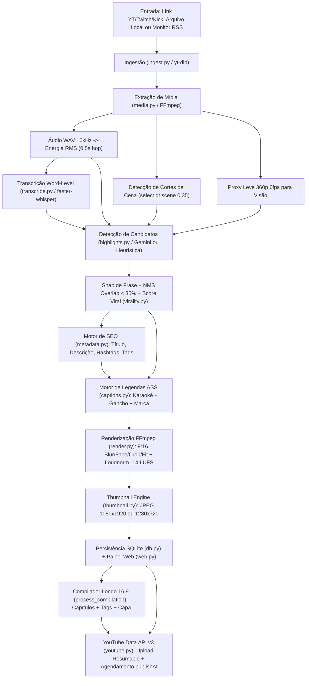

# Software Design Document (SDD) — ClipsReal
**Engenharia Reversa da Plataforma Real Oficial & Arquitetura Completa de Clipagem Automática com IA para Expansão do Canal GTA VI (`@BabyDragonOFC`)**

*Versão 1.0 · Novembro de 2026*

---

## 1. Resumo Executivo e Contexto

O **ClipsReal** é uma plataforma local e auto-hospedada de clipagem automática, reenquadramento vertical, legendagem dinâmica, geração de metadados SEO, pontuação preditiva de viralização e publicação agendada para o YouTube, construída especificamente para escalar o canal **GTA VI (`@BabyDragonOFC`)**.

Este documento apresenta:
1. **A Engenharia Reversa Funcional e Técnica** da plataforma brasileira **Real Oficial (`realoficial.com.br`)**, decompondo cada módulo da ferramenta SaaS em componentes abertos e reproduzíveis.
2. **A Arquitetura Completa do ClipsReal**, implementada neste repositório em Python + FFmpeg + Faster-Whisper + OpenCV + Gemini Multimodal + FastAPI + YouTube Data API v3, pronta para operar sem custo de créditos mensais.
3. **A Especificação Matemática do Score de Viralização (0–100)** e do motor de **SEO Completo** (Shorts e Vídeos Longos 16:9 com capítulos e tags).
4. **O Plano Operacional e Estratégico de Crescimento (Meta: 50M de visualizações em 30 dias)** aproveitando a janela histórica de lançamento de *Grand Theft Auto VI* (19 de novembro de 2026), incluindo modelagem matemática de tráfego, cadência, retenção e mitigação de riscos (cotas da API, Content ID de rádios do jogo e política de conteúdo reutilizado).

---

## 2. Engenharia Reversa da Plataforma Real Oficial (`realoficial.com.br`)

### 2.1 Decomposição Funcional Observada

A partir da análise de produto da plataforma Real Oficial (planos Lite 1.800 cr/mês, Criador 3.000 cr/mês e Viral 5.400 cr/mês), seus recursos públicos se organizam em 8 subsistemas:

| Módulo Real Oficial | Comportamento na Plataforma SaaS | Equivalente Técnico Reconstruído no ClipsReal |
|---|---|---|
| **1. Ingestão Multi-Fonte** | Aceita links de YouTube, Twitch, Kick, Google Drive ou upload MP4 | `ingest.py` via `yt-dlp` (até 1080p MP4 com download concorrente) + upload HTTP multipart em streaming (`8 MB` chunks) |
| **2. Real Clips (Seleção com IA)** | Analisa vídeo longo (rendendo ~20–30 cortes/hora) avaliando humor, tom de voz, expressões, tensão e arco começo-meio-fim | `media.py` + `transcribe.py` + `highlights.py` + `virality.py` (análise multimodal Gemini 360p proxy + Whisper word-level + DSP de energia RMS + corte de cena) |
| **3. Reframe Automático** | Converte 16:9 para 9:16 rastreando rostos ou centralizando ação | `reframe.py` + `render.py` com 4 modos: `blur` (ideal para gameplay GTA 6), `face` (OpenCV YuNet/Haar por plano de cena), `crop` e `fit` |
| **4. Legendas Dinâmicas** | Legendas palavra-por-palavra estilo "Alex Hormozi" em PT-BR (e tradução) | `captions.py` gerando arquivo ASS (`libass`) com destaque dinâmico palavra-por-palavra (`\fscx112\fscy112` + troca de cor), caixa de gancho superior e marca d'água |
| **5. Brand Kit & Edição em Massa** | Logotipo, fontes, cores padrão e ajustes de início/fim em lote | `config.yaml` (identidade visual centralizada) + painel Web para edição rápida de título, descrição, hashtags, tags, gancho e timestamps + re-render em 1 clique |
| **6. Fila Econômica / Queue** | Processamento assíncrono em fila para não travar a interface | `pipeline.py` com filas dedicadas (`_q` de processamento/render e `_upload_q` de upload) persistidas em SQLite |
| **7. Auto Post (Agendamento)** | OAuth oficial com YouTube/redes para publicar e agendar cortes | `youtube.py` (YouTube Data API v3 `videos.insert` resumable + `publishAt` em fuso `America/Sao_Paulo` respeitando limite diário da cota) |
| **8. Capas / Thumbnails & Extras** | Geração de thumbnails e recursos visuais (e módulos generativos como Real Xablau / Influencer de IA) | `thumbnail.py` (Pillow: extração do frame de pico, boost de contraste/saturação, degradê, badge `GTA 6`, tipografia Impact com contorno) |

> **Nota sobre o módulo Real Xablau (troca de personagem/estilo por IA):** na Real Oficial esse módulo depende de modelos de difusão vídeo-para-vídeo em GPU pesada e consome muitos créditos. Para o nicho de **clipagem de GTA 6**, o valor central está em velocidade, fidelidade ao gameplay real de Vice City/Leonida, retenção nos primeiros 3 segundos e escala diária de publicação — tornando a reconstrução local com FFmpeg + Gemini Flash ordens de grandeza mais rápida e sem custo por minuto processado.

### 2.2 Vantagens Competitivas da Ferramenta Própria vs. Real Oficial

1. **Custo Zero de Créditos:** na Real Oficial, 30 horas/mês consomem ~1.800 créditos; no ClipsReal, transcrição (`faster-whisper`), análise de áudio/cena, reframe, legendas e renderização rodam 100% na sua máquina, e a análise semântica usa a API do Gemini (nível gratuito ou centavos por hora de vídeo).
2. **Especialização Extrema no Nicho GTA 6:** prompts, palavras-chave de tendência (`Vice City`, `Leonida`, `Lucia`, `Jason`, `Port Gellhorn`, `Ambrosia`, `Grassrivers`, `Keys`, `easter egg`, `física`, `polícia`) e regras visuais (`blur` + `fg_zoom: 1.15` para destacar HUD e ação) são calibrados para gameplay, não para podcasts genéricos.
3. **Score de Viralização Explicável:** em vez de uma caixa-preta, cada corte exibe a nota 0–100 decomposta em 6 sub-sinais auditáveis.
4. **Modo Compilação 16:9 Automático:** além de gerar Shorts verticais, o ClipsReal monta vídeos longos em 1080p combinando os melhores cortes em curva de retenção (abre com o corte de maior score como gancho e cresce em clímax), calcula capítulos exatos (`00:00`), gera capa `1280×720` e cria **tags completas de vídeo longo** (25–35 tags PT+EN).

---

## 3. Arquitetura do Sistema ClipsReal

### 3.1 Fluxo de Dados End-to-End



### 3.2 Mapa de Módulos (`clipsreal/`)

| Arquivo | Responsabilidade Principal |
|---|---|
| `config.py` | Carrega `.env` + `config.yaml` com defaults seguros, define `DATA` (suporta `CLIPSREAL_DATA` fora do OneDrive) e permite persistir alterações via UI (`set_env_var`, `save_config`). |
| `db.py` | Camada SQLite thread-safe (`RLock`) com 3 tabelas: `jobs`, `clips`, `seen_videos`. Serializa campos JSON (`breakdown`, `hashtags`, `tags`, `options`). |
| `media.py` | Localiza `ffmpeg` (PATH -> WinGet `Gyan.FFmpeg` -> `imageio-ffmpeg`), faz `probe`, extrai WAV 16kHz, gera proxy 360p/6fps, calcula energia RMS normalizada (percentil 98) e detecta mudanças de cena. |
| `ingest.py` | Baixa vídeos via `yt-dlp` (com progresso e merge para MP4) ou valida arquivo local. |
| `transcribe.py` | Executa `faster-whisper` (`small`/`int8` em CPU por padrão, com `vad_filter=True` e `word_timestamps=True`) com cache em `transcript.json`. |
| `llm.py` | Cliente `google-genai` com seleção dinâmica do modelo `gemini-*-flash` mais recente, failover automático entre variantes (`flash` e `flash-lite`) em 503/429/404, `response_mime_type="application/json"` e upload/limpeza de vídeo na Files API. |
| `virality.py` | Calcula o Score de Viralização (0–100) ponderado em 6 dimensões + rótulo (`🔥 Viral`, `Alto`, `Médio`, `Baixo`). |
| `highlights.py` | Orquestra seleção de cortes via Gemini (vídeo proxy + transcrição + picos + densidade de cenas) com fallback heurístico inteligente baseado em picos e palavras-chave de GTA 6. Aplica `_snap` e `_nms`. |
| `captions.py` | Constrói arquivo `.ass` em UTF-8 BOM com estilo `Caption` (palavra ativa destacada em amarelo + zoom 112%), `Hook` (faixa superior branca com texto preto) e `Mark` (`@BabyDragonOFC`). |
| `reframe.py` | Rastreia rosto por plano de cena com OpenCV (`FaceDetectorYN`/YuNet e fallback Haar) e compila a coordenada `x` em expressão FFmpeg `if(lt(t,...),...)`. |
| `render.py` | Renderiza Shorts 9:16 (`blur`, `crop`, `face`, `fit`) com `loudnorm` (`I=-14:TP=-1.5:LRA=11`) e vídeo longo 16:9 (`render_compilation`) com capítulos exatos baseados na duração real codificada. |
| `thumbnail.py` | Gera capas `.jpg` (`1080×1920` para Shorts e `1280×720` para Longos) com realce de contraste/cor, degradê inferior, badge `GTA 6` e texto Impact com contorno preto. |
| `metadata.py` | Gera e sanitiza título (≤100 chars), descrição (≤4900 bytes), hashtags (≤15) e tags (≤480 chars) via Gemini com fallback por template, além de `export_txt` e `sync_clip_files`. |
| `youtube.py` | Autenticação OAuth2 (`InstalledAppFlow`), `videos.insert` resumable (chunks 8 MB), `thumbnails.set`, `channels.list` e agendador `next_slot` em UTC a partir dos horários configurados em `America/Sao_Paulo`. |
| `monitor.py` | Polling periódico do feed Atom/RSS oficial do YouTube (`feeds/videos.xml?channel_id=...`), evitando processar vídeos antigos na 1ª varredura e enfileirando apenas novidades. |
| `pipeline.py` | Gerencia as duas filas worker em background (`pipeline` e `uploads`), executa `process_job`, `render_clip`, `regen_metadata`, `upload_clip` e `process_compilation`. |
| `web.py` + `static/` | Painel web FastAPI em `http://localhost:8000` com preview MP4/capa, barras de breakdown do score, editor completo de SEO, compilador 1-clique e modal de configuração rápida. |
| `cli.py` | Interface de linha de comando: `serve`, `process`, `compile`, `upload`, `auth`, `monitor`, `doctor`. |

### 3.3 Esquema de Dados (SQLite)

```sql
jobs (id, kind ['clip'|'compilation'], source, title, status, stage, progress, message, video_path, duration, options, created_at, updated_at)
clips (id, job_id, kind ['short'|'long'], idx, start, end, score, score_label, breakdown, hook, reason, category, transcript, title, description, hashtags, tags, file_path, thumb_path, status, youtube_id, publish_at, error, created_at)
seen_videos (video_id PK, source, created_at)
```

### 3.4 API REST Local (`FastAPI`)

- `GET /api/status` — Saúde de FFmpeg, `libass`, Gemini, OAuth YouTube, fila e canal.
- `POST /api/jobs` / `POST /api/jobs/upload` — Cria job por URL/caminho ou upload de arquivo.
- `GET /api/jobs` / `GET /api/jobs/{id}` / `POST /api/jobs/{id}/retry` / `DELETE /api/jobs/{id}` — Gestão de jobs.
- `GET /api/clips` / `PATCH /api/clips/{id}` / `POST /api/clips/{id}/render` / `POST /api/clips/{id}/metadata` / `POST /api/clips/{id}/upload` — Edição, re-render, regeneração SEO e agendamento.
- `POST /api/compilation` — Gera vídeo longo 16:9 a partir de 2+ cortes selecionados.
- `GET /api/config` / `POST /api/config` / `POST /api/gemini/test` / `POST /api/youtube/secret` / `POST /api/youtube/auth` / `POST /api/monitor/check` — Configuração e automação completas pela UI.

---

## 4. Especificação Matemática do Score de Viralização (0–100)

Cada candidato recebe uma nota final ponderada entre 0 e 100 em `virality.py`:

$$\text{Score} = \frac{\sum_{i \in S_{\text{ativo}}} w_i \cdot s_i}{\sum_{i \in S_{\text{ativo}}} w_i}$$

Onde os sinais $s_i \in [0, 100]$ e pesos $w_i$ são:

| Sinal | Peso ($w_i$) | Fórmula / Critério de Normalização |
|---|---|---|
| **`llm`** | **45%** | Média das 5 notas de 0–10 dadas pelo Gemini (`hook`, `emotion`, `value`, `trend`, `standalone`) multiplicada por 10. Se a chave Gemini não estiver configurada, este termo sai de $S_{\text{ativo}}$ e os demais pesos são renormalizados automaticamente para somar 100%. |
| **`energy`** | **15%** | Média dos 30% maiores picos de energia RMS do trecho dividida por $(2 \times \mu_{\text{global}})$, limitada a $[0, 100]$. Captura tiroteios, explosões, sirenes e gritos de reação. |
| **`hook`** | **12%** | Nos 3 primeiros segundos do corte: se houver fala, $50\% \cdot \min(\text{palavras}_{0..3s}/6, 1) + 50\% \cdot e_{\max, 0..3s}$; se não houver fala (gameplay puro), $100\% \cdot e_{\max, 0..3s}$. |
| **`dynamics`** | **10%** | Densidade de cortes de cena por 10 segundos ($\text{cuts}_{10s}$): cresce linearmente até o ponto ótimo entre $0.5$ e $4.0$ cortes/10s (100 pts) e penaliza excesso de cortes caóticos acima de 4/10s. |
| **`duration`** | **8%** | Curva em platô: `20s–40s` = `100 pts`; `<20s` perde `7 pts/s` (piso 30); `>40s` perde `3 pts/s` (piso 40). |
| **`trend`** | **10%** | `35 + 15 × hits` limitado a `100`, medindo ocorrências de `trend_keywords` do nicho GTA 6 na fala, gancho e motivo. |

**Classificação Visual:**
- `>= 85`: **🔥 Viral** (prioridade máxima para publicar nos horários nobres e abrir compilações)
- `70 – 84.9`: **Alto**
- `55 – 69.9`: **Médio**
- `< 55`: **Baixo** (descartado pelo filtro padrão `min_score: 50`)

---

## 5. Motor de SEO Completo (Shorts vs. Vídeo Longo)

1. **Shorts (9:16 até 58s):**
   - **Título (40–70 chars):** utiliza *curiosity gap* + menção natural a `GTA 6`, sem caracteres inválidos `< >`.
   - **Descrição:** 1ª linha com gancho indexável + contexto curto + CTA de inscrição + 3–5 hashtags no rodapé.
   - **Hashtags:** sempre inclui `#GTA6`, `#GTAVI` e `#Shorts` + contextuais (`#ViceCity`, `#Lucia`, `#Jason`, `#EasterEgg`).
   - **Tags:** até 450 caracteres com variações PT+EN (`gta 6`, `gta vi`, `gta 6 gameplay`, `gta 6 brasil`, `vice city`, etc.).
2. **Vídeos Longos (16:9 Compilação):**
   - **Ordenação Estratégica de Retenção:** ordena os cortes em ordem crescente de score e coloca o **melhor corte (maior score) abrindo o vídeo no minuto `00:00`** para derrubar o *drop* inicial de retenção dos primeiros 30 segundos, encerrando com o segundo maior clímax.
   - **Capítulos Automáticos (`00:00`):** calculados a partir da duração real de cada segmento renderizado em `render_compilation`, habilitando barra de capítulos no player do YouTube.
   - **Tags de Vídeo Longo:** 25–35 tags misturando cauda curta (`gta 6`, `gta vi`) e cauda longa (`gta 6 melhores momentos`, `gta 6 compilação`, `gta 6 pt br`), respeitando o limite estrito da API do YouTube (<500 caracteres totais).
   - **Thumbnail Dedicada (`1280×720`):** gerada automaticamente do corte de maior score e enviada via `thumbnails.set` (requer canal verificado por telefone no YouTube Studio para miniaturas personalizadas).

---

## 6. Integração YouTube API, Cotas e Segurança de Conteúdo

### 6.1 Limites Reais da YouTube Data API v3
- A cota padrão de qualquer projeto novo no Google Cloud é de **10.000 unidades/dia**.
- Cada chamada `videos.insert` consome **1.600 unidades** (+ ~50 unidades se `thumbnails.set` for chamada).
- Logo, o limite matemático na cota padrão é **6 uploads por dia** (`6 × 1.600 = 9.600` unidades). Por isso `config.yaml` já vem travado em `max_per_day: 6`.
- Para subir **12 a 24+ vídeos/dia**, é obrigatório solicitar **Quota Extension** no Google Cloud Console (formulário *YouTube API Services - Audit and Quota Extension*). Enquanto a extensão não é aprovada, o agendador distribui os excedentes automaticamente nos próximos dias sem perder nenhum corte.

### 6.2 Riscos Críticos de Direitos Autorais e Monetização (GTA 6)
1. **Músicas das Rádios do GTA 6 (Content ID):** transmissões e gameplays com música licenciada tocando no rádio do carro geram reivindicações de Content ID imediatas ou bloqueio mundial. *Recomendação operacional:* gravar com música do rádio desligada nas configurações de áudio do jogo ou usar cortes com foco em diálogo/efeitos sonoros/reação.
2. **Política de Conteúdo Reutilizado (*Reused Content*):** subir clipes crus de terceiros sem transformação derruba o alcance e impede monetização no YPP. As camadas nativas do ClipsReal (reenquadramento + zoom/blur, faixa de gancho no topo, legenda dinâmica palavra-por-palavra, marca d'água do canal, normalização de áudio e compilação temática com capítulos) adicionam valor editorial visível — e, sempre que possível, priorize **seus próprios VODs/gameplays**, trailers oficiais analisados/comentados ou parcerias autorizadas com streamers.
3. **Verificação de Canal:** habilite os **Recursos Avançados** no YouTube Studio (verificação por telefone + histórico/documento) para liberar upload acima de 15 min, links clicáveis, thumbnails personalizadas via API e maior limite diário de publicação.

---

## 7. Estratégia de Expansão para Buscar 50 Milhões de Views (`@BabyDragonOFC`)

**Momento de mercado (18 de novembro de 2026):** estamos na véspera exata do lançamento mundial de *Grand Theft Auto VI* (19/11/2026). Nas primeiras 2 a 4 semanas de um lançamento histórico desse porte, o volume de busca e o apetite algorítmico do feed de Shorts por GTA 6 atingem seu pico máximo da década.

### 7.1 Matemática Realista dos 50M em 30 Dias

Atingir 50 milhões de visualizações em ~30 dias exige uma **distribuição em lei de potência (efeito bola de neve)**, onde centenas de Shorts alimentam o algoritmo até 10–25 vídeos "outliers" romperem a barreira de 1M–5M+ views cada:
- **Cenário base de escala (Shorts + Longs):**
  - 6 Shorts/dia × 30 dias = **180 Shorts/mês** (expandindo para 12–18/dia após aprovação de cota ou postagem complementar no YouTube Studio).
  - Média de base (cortes normais): 15k–40k views/vídeo (~4–7M).
  - 15–20 cortes *breakout* (score ≥ 85, retenção > 95%): 500k–1.5M views cada (~15–22M).
  - 3–6 megavirais globais (conteúdo puramente visual / física / segredo chocante sem barreira de idioma): 3M–8M+ views cada (~20–30M).
  - 1–2 compilações longas/semana (8–15 min, 16:9) reaproveitando os melhores Shorts validados: captura tráfego de busca (*Browse + Suggested*) e aumenta horas assistidas para monetização.

### 7.2 Protocolo Diário de Operação (Playbook)

1. **Regra dos 3 Segundos (Filtro Interno):** só agende cortes com `Score >= 80` nos horários nobres (`18:30`, `20:00`, `21:30`). Em Shorts de GTA 6, o 1º frame já deve mostrar ação, acidente, rosto de personagem ou texto-gancho forte — zero silêncio inicial.
2. **Pilares de Maior Retenção no Nicho GTA 6:**
   - **Detalhes Absurdos / Física Realista** (água, destruição, comportamento de NPCs, polícia inteligente).
   - **Easter Eggs & Segredos de Vice City / Leonida** (referências a GTA V, Vice City clássico, eventos aleatórios).
   - **Comparações Diretas (GTA V vs GTA VI)** lado a lado ou corte rápido.
   - **Bugs Hilários e Caos de Lançamento** (altíssimo compartilhamento e comentários no dia 1–7).
   - **Missões / Lucia & Jason sem Spoiler Pesado no Título** (curiosidade imediata).
3. **Alavanca Multi-Idioma (Segredo dos Canais de 50M+):** cortes puramente visuais de física, easter eggs ou reações curtas com texto-gancho em inglês ou legendas universais atingem o feed dos EUA, Europa e América Latina (onde o RPM também é 3× a 6× maior que o Brasil). Você pode criar uma variação rápida ajustando o título/gancho em inglês para horários da madrugada/manhã (ex.: `07:30` e `23:00`).
4. **Loop de Feedback Semanal (Métricas do YouTube Studio):**
   - **Shorts:** meta de **> 80–85% "Visualizaram vs. Deslizaram"** (*Viewed vs. Swiped Away*) e **> 100% de retenção média** (vídeos de 20–32s com payoff no último segundo geram replay automático).
   - **Longos (Compilações):** meta de **CTR > 8%** nas primeiras 24h e **retenção aos 0:30 > 65%**. Se o CTR estiver abaixo de 5%, troque a `thumb.jpg` e o título pelo 2º melhor gancho do vídeo.
   - Retroalimente as palavras vencedoras em `trend_keywords` no `config.yaml` toda semana!
